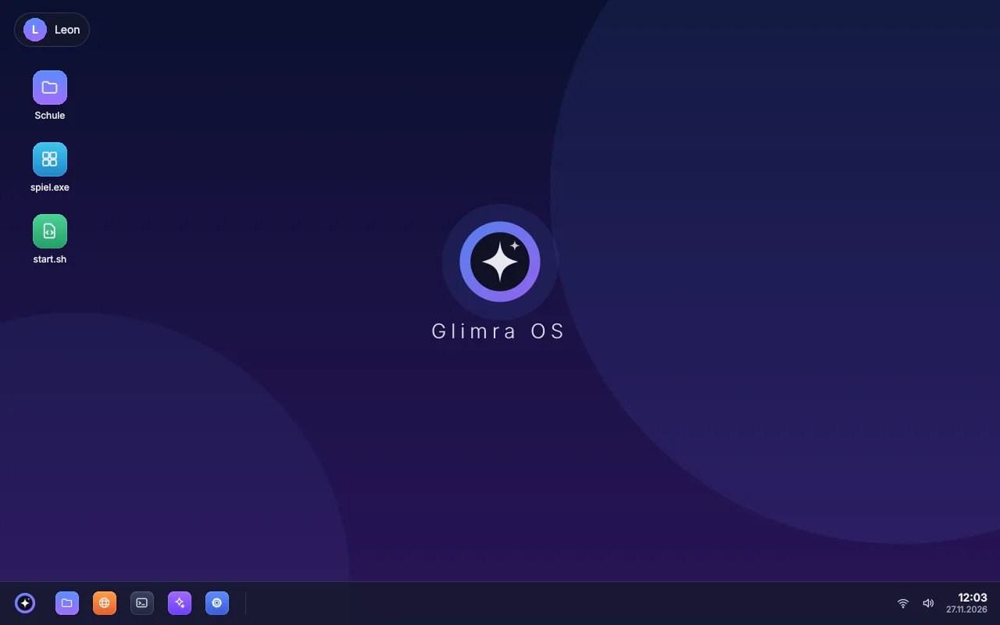

<p align="center"></p>
<h1 align="center">Glimra OS</h1>
<p align="center"><b>Das Betriebssystem, das einfach leuchtet.</b><br>
Eigene Oberfläche · Sprachassistent · Handy-App · automatische Backups · leichter Wechsel von Windows</p>
<p align="center">
  <a href="https://github.com/therealflutlup/glimraos/releases/latest"></a>
  <a href="https://github.com/therealflutlup/glimraos/actions/workflows/build.yml"></a>
  <a href="LICENSE"></a>
</p>

<p align="center"></p>

## Download

| Datei | Wofür |
|---|---|
| **glimraos-desktop-…-x86_64.iso** | Glimra OS für PC und Laptop |
| **glimraos-server-…-x86_64.iso** | Glimra OS als Heimserver mit Glimra Panel |
| **GlimraSetup.exe** | Wechsel von Windows: PC prüfen, ISO laden, USB-Stick, Daten-Umzug |
| **GlimraApp-….apk** | Handy-App (Android 8+) |

→ [Neuestes Release](https://github.com/therealflutlup/glimraos/releases/latest) · [Webseite](https://therealflutlup.github.io/glimraos/) · [Handbuch](docs/HANDBUCH.md)

Voraussetzungen: 64-Bit-PC mit UEFI, 4 GB RAM, Secure Boot aus.

## Funktionen

- **Glimra Shell** – eigene Oberfläche (Wayland-Compositor) mit Desktop, Taskleiste, Startmenü, Rechtsklick-Menü, Sperrbildschirm und eigenem Symbolset
- **Wie Windows** – Windows-Taste, Win+E/I/L/D/A/V, Alt+Tab, Fenster andocken, Schnelleinstellungen, Info-Center, Zwischenablage-Verlauf, Bildschirmfoto
- **Glimra Store & Update** – Programme per Klick installieren, Updates mit automatischem Backup
- **Sparsam** – Oberfläche braucht im Leerlauf ca. 110 MB RAM und 0 % CPU; komprimierter Arbeitsspeicher (zram)
- **Einrichtung** – „Wofür verwendest du mich?“ installiert Programme für Gaming, Leistung, Arbeit oder Arbeits-Apps
- **Assistent** – deutsche Befehle getippt oder gesprochen, offline
- **GlimraApp** – PC sperren, Zwischenablage, Dateien, Lautstärke, Medien und Energie vom Handy; „Teilen“ an den PC
- **Backups** – vor jedem Update; bei Startproblemen lädt Glimra OS selbst den letzten guten Stand
- **Sicherheit** – Firewall und Virenscan per Klick
- **Spiele** – Steam, Proton, Wine; `.exe`-Dateien per Doppelklick
- **Virtuelle PCs**, **Umzug** von Windows/Linux, **Netzwerk-Tools**, **Taskmanager**, **Rechner**, **Hilfe**
- **Glimra OS Server** – Glimra Panel im Browser (HTTPS): Dienste, Benutzer, Freigaben, Snapshots, Updates

## Projektaufbau

```
shell/      Glimra Shell (Python + QML)            panel/     Glimra Panel (Server-Weboberfläche)
android/    GlimraApp (Kotlin + HTML)              windows/   Glimra Setup-Manager (→ GlimraSetup.exe)
profiles/   ISO-Inhalte, Installer, Systemhelfer  site/      Webseite (GitHub Pages)
branding/   Symbolset, Logo, Icons                tests/     automatische Tests
docs/       Handbuch, Datenschutz                 tools/     Version setzen, App-Schlüssel
```

## Selbst bauen und veröffentlichen

Alles baut GitHub automatisch (ISO, APK, EXE). Einmalige Einrichtung und jede neue Version:
siehe **[docs/VEROEFFENTLICHEN.md](docs/VEROEFFENTLICHEN.md)**.

Lokal ausprobieren: `preview-windows.bat` (Windows) oder `./preview-linux.sh` zeigt die Glimra Shell als Fenster.
Tests: `python3 -m pytest`.

## Mitmachen & Sicherheit

[CONTRIBUTING.md](CONTRIBUTING.md) · [SECURITY.md](SECURITY.md) · [CHANGELOG.md](CHANGELOG.md) · [Fremdsoftware](THIRD_PARTY.md)

Glimra OS ist freie Software unter der [GNU GPL v3](LICENSE). Basiert auf Arch Linux, ist aber kein offizielles Arch-Projekt.
